# Modelo de datos (entidad–relación)

Todas las tablas de negocio llevan `institucion_id` (aislamiento multi-institución). Los montos son `DECIMAL` (sin flotantes).

```mermaid
erDiagram
    INSTITUCION ||--o{ MEMBRESIA : "asigna rol a"
    USUARIO ||--o{ MEMBRESIA : tiene
    INSTITUCION ||--o{ PERIODO : "mes a mes"
    INSTITUCION ||--o{ BITACORA : audita

    ELEMENTO ||--o{ RECURSO : agrupa
    RECURSO ||--o{ CUENTA_RECURSO : "prefijo de cuenta →"
    UNIDAD_NEGOCIO ||--o{ CENTRO_COSTO : agrupa
    SEDE ||--o{ CENTRO_COSTO : ubica
    CENTRO_COSTO ||--o{ HOMOLOGACION_CENTRO : "código contable →"

    INDUCTOR ||--o{ VALOR_INDUCTOR : "cantidad por centro"
    CENTRO_COSTO ||--o{ VALOR_INDUCTOR : destino
    PERIODO |o--o{ VALOR_INDUCTOR : "vacío = permanente"
    INDUCTOR ||--o{ REGLA_DISTRIBUCION : usa
    RECURSO |o--o{ REGLA_DISTRIBUCION : "1ª distribución"
    CENTRO_COSTO |o--o{ REGLA_DISTRIBUCION : "origen (N3)"
    UNIDAD_NEGOCIO |o--o{ REGLA_DISTRIBUCION : "origen (N2)"
    PERIODO |o--o{ REGLA_DISTRIBUCION : "excepción (N4)"
    CENTRO_COSTO ||--o{ DISTRIBUCION_MANO_OBRA : "% Empleado / OPS"

    CUPS ||--o{ CUPS_CENTRO_COSTO : "producido en (peso)"
    CENTRO_COSTO ||--o{ CUPS_CENTRO_COSTO : produce
    AMBITO ||--o{ AMBITO_HOMOLOGACION : "valor origen →"
    EPS ||--o{ NOTA_TECNICA : contrata
    NOTA_TECNICA ||--o{ NOTA_TECNICA_ITEM : "tarifa por CUPS"
    CUPS ||--o{ NOTA_TECNICA_ITEM : tarifa

    PLANTILLA_MAPEO ||--o{ CARGA : "columnas →"
    PERIODO ||--o{ CARGA : recibe
    CARGA ||--o{ ERROR_CARGA : reporta
    CARGA ||--o{ MOVIMIENTO_CONTABLE : "fila del archivo"
    CARGA ||--o{ PRODUCCION : ""
    CARGA ||--o{ FACTURACION : ""
    CARGA ||--o{ RIPS : ""
    RECURSO ||--o{ MOVIMIENTO_CONTABLE : clasifica

    PERIODO ||--o{ CORRIDA : "ejecución del motor"
    CORRIDA ||--o{ ASIGNACION : "1ª a 4ª distribución"
    MOVIMIENTO_CONTABLE |o--o{ ASIGNACION : "fuente (1ª)"
    CENTRO_COSTO ||--o{ ASIGNACION : "origen / destino"
    INDUCTOR |o--o{ ASIGNACION : "tasa = base / total inductor"
    CORRIDA ||--o{ PENDIENTE : "no asignado"
    CORRIDA ||--o{ COSTO_CUPS : "costo por CUPS"
```

## Entidades principales

| Entidad | Propósito | Campos clave |
|---|---|---|
| `Institucion` | IPS / ESE / red | código REPS, NIT, nombre |
| `Membresia` | Usuario ↔ institución con **rol** (ADMIN, FINANCIERO, COSTOS, AUDITORIA, GERENCIA, CONSULTOR) | usuario, institución, rol, activo |
| `Periodo` | Mes contable; `CERRADO` bloquea cambios | año, mes, estado |
| `Bitacora` | Auditoría inmutable (accesos, cargas, cambios antes/después, corridas, exportaciones) | fecha, usuario, acción, detalle JSON, IP |
| `Elemento` | CP, IH, CG, EC (Anexo Técnico 2) | código, nombre |
| `Recurso` | R1…R29; tipo de mano de obra (EMPLEADO/OPS); clases que lo pueden recibir | código, elemento, inductor convenido |
| `CuentaRecurso` | Cuenta o prefijo del plan de cuentas → recurso (prefijo más largo gana) o `excluir` | prefijo, recurso |
| `UnidadNegocio` | Agrupa centros con igual finalidad; define la **clase** | código, clase |
| `CentroCosto` | Unidad de producción; clase ESTRUCTURA / SERVICIOS / INTERMEDIOS / FINALES; sede | código, unidad, clase, sede |
| `HomologacionCentro` | Código/nombre contable de la institución → centro del modelo | código origen |
| `Inductor` | Criterio de distribución: CANTIDAD, PRODUCCION, COSTO_DIRECTO, FACTURACION | código, tipo |
| `ValorInductor` | Cantidad por centro destino (y opcionalmente por centro origen), por periodo o permanente | cantidad |
| `ReglaDistribucion` | Qué inductor y qué clases destino usa cada distribución; su alcance define el nivel N1–N4 | distribución, alcance, inductor |
| `DistribucionManoObra` | % por centro para cada documento (Empleado / OPS) | tipo, documento, centro, % |
| `Cups`, `CupsCentroCosto` | Catálogo editable y centro que produce cada CUPS con peso relativo (UVR/minutos) | código, peso |
| `Eps`, `NotaTecnica`, `NotaTecnicaItem` | Contratos (evento, cápita, PGP, paquete), vigencia, tarifa por CUPS | modalidad, tarifa |
| `Ambito`, `AmbitoHomologacion` | Ámbitos de facturación (software 360/RIPS) y equivalencias | código |
| `PlantillaMapeo` | Mapeo de columnas por institución y tipo de archivo | mapeo JSON, constantes, fila encabezado |
| `Carga`, `ErrorCarga` | Archivo cargado (hash SHA-256, usuario, estado, conteos) y sus errores por fila | — |
| `MovimientoContable` | Costo del mes por cuenta/recurso/centro; `fuente` EF (estado financiero) o AREA (soporte) | carga, fila, valor |
| `Produccion`, `Facturacion`, `Rips` | Producción por centro y CUPS; facturación y RIPS (paciente seudonimizado) | carga, fila |
| `Corrida` | Ejecución del motor para un periodo; resumen de conservación; huella de parámetros | vigente |
| `Asignacion` | Cada asignación: distribución, recurso, origen, destino, método, inductor, base, cantidad, total inductor, **tasa**, ajuste de conciliación, valor, movimiento fuente | — |
| `Pendiente` | Costo no asignado y su motivo | — |
| `CostoCups` | Costo total y unitario por centro final y CUPS, con composición por elemento | — |

## Cadena de trazabilidad

`CostoCups → CentroCosto final → Asignacion (4ª,3ª,2ª: centro origen + inductor + tasa) → … → Asignacion 1ª → MovimientoContable → Carga (archivo, hoja, SHA-256, usuario) + fila + Periodo`.
La pantalla *Trazabilidad* y su exportación a Excel recorren esta cadena.
